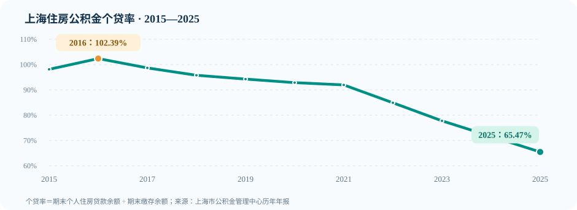

# 上海住房公积金制度实证研究（2015—2025）

> **Shanghai Housing Provident Fund | Evidence-based Research**  
> 以2025年为核心，研究上海住房公积金的资金流动、福利分配、住房金融效率与治理机制。

   

**这是一个可复算的公开研究项目，而不是官方审计或已完成的因果研究。** 公开数据、制度推论与待核实假说分别标记；缺失数据保持缺失，绝不人工填补。

## 研究看板 · 2025

| 缴存额 | 提取额 | 年末缴存余额 | 年末个人住房贷款余额 |
| ---: | ---: | ---: | ---: |
| **2,663.65 亿元** | **1,842.64 亿元** | **9,466.59 亿元** | **6,197.93 亿元** |

| 关键指标 | 2016 | 2025 | 如何理解 |
|:--|--:|--:|:--|
| 个贷率 | 102.39% | 65.47% | 由早年较高贷款运用水平转向资金积累相对更快 |
| 2025贷款净新增 | — | 5.99亿元 | 当年发放869.60亿元、回收863.61亿元 |
| 2025银行存款 | — | 3,287.72亿元 | **不等同于闲置资金** |
| 2025增值收益 | — | 114.94亿元 | 需结合平均资产、利率和期限进一步评价 |

数据来源：[上海市住房公积金2025年年度报告](https://www.shzfgjj.cn/html/newxxgk/ndbg/228312.html)。历史各年原始链接见 [sources/manifest.csv](sources/manifest.csv)。



[](https://github.com/1998x-stack/shanghai-hpf-research/actions/workflows/ci.yml)

## 第二轮跨来源研究（2026-10-27）

新加入[跨来源证据报告](docs/SECOND_PASS_EVIDENCE_2026-10-27.md)：用**上海统计局的房地产交易统计**、**公积金管理中心单位财政预算**和**贷款管理条例**交叉审查贷款需求、信贷资格与管理成本。2025年新房公积金贷款笔数估算同比约-31.58%，但同年新建住宅销售面积同比约-9.71%，**两项不是可直接相除的同一口径**。另发现年报投诉协调率的公布值与直接采用全部投诉件数作分母的结果不同，列为“分母待核实”，不推断造假。

- [跨来源原始数值及单位](data/external/observations_2024_2025.csv)
- [资金账与财政预算桥接研究](docs/SECOND_PASS_EVIDENCE_2026-10-27.md#2-财政预算与公积金资金账本之间存在一座尚未建立的桥)
- 复算：`python -c "from hpf_research.external import triangulate; import pprint; pprint.pp(triangulate())"`

## 首轮发现

1. **资金运行模式发生变化。** 2016年个贷率102.39%，当年贷款余额勾稽必须扣除312.02亿元资产证券化转出；2025年降至65.47%。对比并不直接证明资金闲置或政策失效。
2. **存量增长与收益背离。** 2025年末缴存余额同比增长9.50%，增值收益由2024年的139.68亿元降至114.94亿元。需要进一步分析利差、资产期限和资金成本。
3. **缴存制度允许差异化单位福利。** 基本与补充住房公积金制度使同等缴存基数下的单位缴存额不同；但目前**没有**充分数据计算机关事业单位、国企、民企的真实资金占比。
4. **披露口径存在断点。** 2024年细分单位性质，2025年采用企业/非企业/灵活就业的较粗分类，不能直接跨年映射。
5. **区级数据仍需补齐。** 2025年16区 × 12个月应有192条地区-月份记录，目前已核验2025年8月的16条（**8.33%**）。

详细证据和竞争性解释： [完整研究报告](reports/full_research_report.md) · [发现与证据](reports/findings_and_evidence.md) · [研究局限](reports/limitations.md)。

## 研究框架


## 立即开始

```bash
git clone https://github.com/1998x-stack/shanghai-hpf-research.git
cd shanghai-hpf-research
python -m pip install -e ".[dev]"
python -m pytest -q
python -m hpf_research.audit
```

复算无需官方站点实时可用；存储的是**带源链接的官方数值转录**，非官方HTML原件。 `python -m hpf_research.audit` 输出年度个贷率、资金勾稽残差和2025年月度覆盖率。

### 内容索引

| 路径 | 用途 |
|:--|:--|
| [reports/full_research_report.md](reports/full_research_report.md) | 制度机制、核心计算、反证与局限 |
| [reports/executive_summary.md](reports/executive_summary.md) | 快速阅读 |
| [data/raw/](data/raw/) | 官方年报数值转录、单位性质统计 |
| [data/processed/](data/processed/) | 2025年8月16区数据、2025年192行覆盖矩阵 |
| [policies/](policies/) | 适用年份与政策生效日期 |
| [sources/manifest.csv](sources/manifest.csv) | 原始材料索引、采集状态 |
| [docs/METHODOLOGY.md](docs/METHODOLOGY.md) | 单位、分母、会计公式和识别边界 |
| [docs/ROADMAP.md](docs/ROADMAP.md) | 公开资料补全和研究验收路线 |
| [analysis/](analysis/) | 复算程序和独立测试 |

## 可验证性与已知不足

- **完成：** 2015—2025年11个年度核心表、2025年8月16区截面、2024/2025财务对照、会计勾稽模型、政策与数据口径问题清单。
- **未完成：** 2025年其余11个月完整16区明细；原始HTML/PDF快照及SHA256；机关事业单位、国企及民企按实际缴存金额和贷款受益分组统计；充分识别的政策因果评估。
- **验证原则：** 核心金额逐条附官网来源；0.01亿元的舍入误差单独标明；2016年证券化转出作为显式调整；不将任何区级单位所在地数据解读为居民居住地数据。

欢迎以来源页面、相同口径的补充数据或可复现代码提交 Issue / PR。所有外部贡献必须附采集日期、原始网址、统计单位和口径说明。

## 声明

本仓库为独立研究，不隶属上海市公积金管理中心。研究材料不构成法律、贷款或投资建议。报告基于已取得的公开资料，其结论可随新证据修订。研究文字与图表按 [CC BY 4.0](LICENSE) 许可公开，官方资料仍归原权利主体所有；源代码按 [MIT](LICENSE-CODE) 许可发布。
