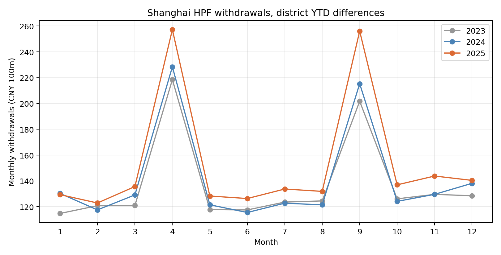

# 2022—2025年上海16区住房公积金月度面板：季节性与跨表桥接

**数据**：上海市公积金管理中心连续48份官方月报、每份16区，共768条；原件和SHA-256见[来源台账](../sources/manifest.csv)，原始转录见 `data/processed/district_monthly_20xx_coverage.csv`，逐月汇总见 [`city_monthly_flows_2022_2025.csv`](../data/processed/city_monthly_flows_2022_2025.csv)。月报金额为年内累计，本文单月流量均以当月减上月计算。区级归属不是居民居住地。

## 1. 可重复的提取月份高峰

| 年份 | 4月提取增量 | 9月提取增量 | 两月占全年提取 |
|---:|---:|---:|---:|
| 2022 | 145.98 | 173.50 | 23.16% |
| 2023 | 218.49 | 201.72 | 25.55% |
| 2024 | 228.40 | 215.29 | 26.19% |
| 2025 | 257.21 | 256.02 | 27.85% |

金额单位亿元；展示值四舍五入。2022年存在特殊冲击，适合作为异常年份记录，不宜与后续年份直接平均作政策反事实。2023和2024年同月高峰发生在[2024年11月租赁提取优化](https://www.shzfgjj.cn/html/newxxgk/zcwj/gfxwj/224701.html)之前。因此，2025高峰并非该新政独有。2025年4月、9月较2024年同期合计多提约69.54亿元，占全年提取增量148.74亿元的46.75%。这个“增长贡献”是会计分解，不能解释政策因果。

## 2. 区表归集与年报缴存的稳定口径差

| 年份 | 年报缴存额 | 12月区表归集 | 差额 | 缴存人利息支出 | 差额减利息支出 |
|---:|---:|---:|---:|---:|---:|
| 2022 | 2,227.22 | 2,134.70 | 92.52 | 98.79 | -6.27 |
| 2023 | 2,473.10 | 2,367.55 | 105.55 | 111.77 | -6.22 |
| 2024 | 2,594.47 | 2,476.14 | 118.33 | 125.20 | -6.87 |
| 2025 | 2,663.65 | 2,532.04 | 131.61 | 138.15 | -6.54 |

金额单位亿元。四年中，区表提取年末汇总均与年报提取额相差不超过0.003亿元，符合年报舍入精度；归集差额则远超舍入。年报明确“缴存额”含结转利息，而区表仅写“本年归集”。利息支出与差额高度接近并逐年同步变化，但**利息支出不自动等于当年结转入职工账户的金额**。稳定约6—7亿元剩余差额说明还需官方的账户和项目调节表，不能将整笔差额精确归因于利息。全精度见 [`annual_district_bridge_2022_2025.csv`](../data/processed/annual_district_bridge_2022_2025.csv)。

## 3. 对政策识别的影响

月报没有租房、还贷、退休等事项的**逐月金额**，而租赁政策影响全市，16区不能天然充当未处理对照组。用四年总提取对2024年11月政策做中断时间序列或双重差分，既无法隔离租房结果变量，也无法排除重复季节性、其他政策和住房市场冲击。年报2025年租房提取284.25亿元及2024年估计约206.66亿元能够支持“租房项目对总增长贡献较大”的会计结论，仍不能给出政策净效果。下一步应取得已有的按事项月度提取表、首次申请与老申请分组及资格分母。
